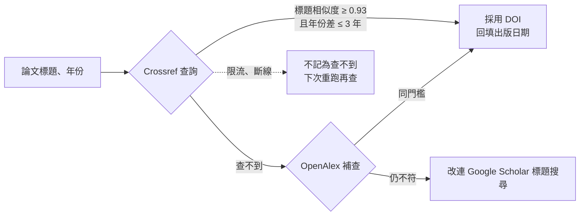

# 成果報告書

## NCU Research Gateway 中央研究能量地圖
### ——結合網頁爬蟲、論文 DOI 溯源與生成式 AI 的研發媒合平台

| 項目 | 內容 |
|---|---|
| **主題類別** | 教研品質（智慧研發支援）＋ 行政運作（產學媒合、無國界校園服務） |
| **題目** | NCU Research Gateway 中央研究能量地圖：以網頁爬蟲、論文 DOI 溯源與生成式 AI 建構可驗證的全校研究能量與產學媒合平台 |
| **對應單位** | 研究發展處（產學營運）、國際事務處、教務處（招生）、計算機與資訊中心、人事室、各系所 |
| **程式碼** | <https://github.com/cooldragonboat/AI-competition>（`research_db/` 資料 pipeline、`web/` 網站） |
| **資料快照** | 2026-10-07（網站資料）；DOI 抽樣驗證 2026-10-23 |

---

## 一、計畫摘要

中央大學的研究成果分散在 iTeacher 教師履歷平台、66 個單位系網、實驗室網站與中大新聞網，格式不一、更新不同步。企業不知道該找哪位老師，學生不知道該加入哪個實驗室，跨系團隊也不知道彼此在做什麼。

本計畫建置「NCU Research Gateway 中央研究能量地圖」，用三層技術把分散的公開資料變成**可查詢、可驗證、可追溯**的研究能量資訊：

1. **網頁爬蟲**：遵守 `robots.txt` 與請求間隔，自動爬取 iTeacher 全校 **960 位**教師資料（論文 52,569 筆、計畫 7,926 筆、獲獎 3,571 筆、專利 1,557 筆、競賽 2,326 筆、學術活動 4,656 筆），再從系所網站一路追到實驗室網站，並爬取中大新聞網近五年新聞配對教授。
2. **論文 DOI 溯源**：iTeacher 只有論文標題，沒有原文連結。我們用標題查 Crossref／OpenAlex 找 DOI，查了 **13,004 篇**不重複論文，找到 **9,764 篇（75.1%）**，平均標題相似度 **0.9987**。網站上 **71.8%** 的論文能一鍵連到出版社原文，還有 1,011 篇的出版年份依 DOI 更正。我們另外**獨立抽樣 60 筆回查 Crossref，60 筆全部正確**。
3. **生成式 AI 與 Agentic 流程**：以 Gemma 4 依各教師「近五年實際論文與計畫」產生研究總結，每項重點都附上依據；也偵測**自填專長與實際研究的落差**。可判定的 653 位教師中，**28.9%** 有中度以上落差。網站另有 RAG 語意搜尋：使用者選擇學生、企業、研究者或國際訪客身分，用自然語言提問，系統就推薦教授並說明理由，而且只能引用資料庫內容。

成果是一個已可部署的雙語網站，收錄 **667 位**專任／合聘／榮譽教授、**48 個**系所與 **18 個**研究領域。網站提供研究能量地圖、系所頁、領域頁、教授頁、探索研究與 AI 問答。整套 pipeline 可以中斷後續跑，輸入沒變的資料不會重算，維運成本低，也能移植到使用類似教師履歷系統的其他大學。

**關鍵字**：網頁爬蟲、DOI、Crossref、OpenAlex、生成式 AI、RAG、Agentic AI、校務研究（IR）、產學媒合、研究能量

---

## 二、研究動機與問題定義

### 2.1 研究動機

中大的研究實力不缺，例如月震、冰下湖研究，以及資工團隊連續六年拿下 BioASQ 冠軍。真正缺的是讓外部找得到這些成果的入口。我們在實際爬取過程中量化了四個痛點：

| # | 痛點 | 實測證據 | 影響對象 |
|---|---|---|---|
| P1 | **資訊分散** | 教師資料散在 iTeacher 與 66 個單位系網，各系網版型不同（標籤、表格、彈出視窗、JS 渲染），部分系網主機無回應 | 所有使用者 |
| P2 | **連結失效** | iTeacher 上教師自填的個人網頁連結中，有填寫的 630 筆內 **381 筆（60.5%）已失效** | 企業、學生 |
| P3 | **自填專長過時** | AI 比對近五年實際產出後，653 位資料足夠的教師中 **189 位（28.9%）** 有中度以上的「專長落差」（中度 174、高度 15） | 企業、研究者 |
| P4 | **成果無法溯源** | iTeacher 的論文只有標題、年份、期刊名，**沒有 DOI 或原文連結**；登錄年份與正式出版年份也常不一致 | 研究者、研發處、國際訪客 |

### 2.2 問題定義

本計畫要回答三個問題：

- **Q1（整合）**：能否在不增加教師填報負擔的前提下，自動把分散的公開資料整合成單一、可更新的研究資料庫？
- **Q2（可信）**：AI 產生的研究摘要與推薦，能否做到**每一項都有依據**、可回溯原文，而不是黑箱生成？
- **Q3（媒合）**：能否讓不同身分的使用者（學生／企業／研究者／國際訪客）**用自己的話**找到對的教授、實驗室與成果？

### 2.3 對應的校務核心痛點

| 校務面向 | 痛點 | 本平台的解法 |
|---|---|---|
| 行政運作（研發處） | 產學媒合靠人脈與人工查詢，企業窗口不知從何找起 | 企業身分 AI 問答直接推薦合作教授，附過往產學計畫與可合作產業 |
| 教研品質 | 跨領域合作難以發生 | 研究能量地圖顯示同一領域橫跨哪些系所，例如「人工智慧」有 192 位教授分布在 33 個系所 |
| 決策品質（IR） | 缺乏全校研究能量的客觀量化 | 以近五年論文、計畫、產學、獲獎與專利建立研究能量指標，可依教授、系所或領域彙整 |
| 國際化 | 國際訪客看不懂中文資料 | 全站中英切換，AI 摘要有英文版，另以 AI 翻譯 2,114 筆獎項、機構與新聞標題 |

---

## 三、方法實施

### 3.1 系統架構

```mermaid
graph LR
    S1[iTeacher 教師履歷平台] -->|scrape.py| R[(原始 HTML 快取)]
    S2[66 個系所網站<br>實驗室網站] -->|scrape_labs.py<br>含 headless Chromium| R
    S3[中大新聞網] -->|ncu_news.py| R
    R -->|build_db.py 解析| DB[(SQLite<br>ncu_research.db)]
    DB -->|summarize.py<br>Gemma 4| AI[AI 研究總結<br>含依據與落差]
    DB -->|extract_labs.py<br>Gemma 4／規則式| LAB[實驗室資訊]
    DB -->|find_dois.py| DOI[Crossref／OpenAlex<br>DOI 與出版日期]
    AI & LAB & DOI -->|export_web.py<br>enrich_web.py| J[網站 JSON]
    J -->|build_rag_index.py<br>gemini-embedding-2| V[向量索引 int8 ~1MB]
    J --> W[React 網站<br>研究能量地圖]
    V --> F[Netlify Functions<br>RAG 問答]
    W <--> F
    J -->|check_links.py| Q[約 1.2 萬個外部連結健檢]
```



### 3.2 模組一：網頁爬蟲（資料蒐集）

| 步驟 | 程式 | 做法 | 規模 |
|---|---|---|---|
| 教師目錄與履歷 | `scrape.py` | 取得 iTeacher 的 Laravel CSRF token 與 session，分頁抓教師目錄（每頁 48 筆），再抓每位教師的履歷頁 | 960 位，約 15 分鐘 |
| 解析建庫 | `build_db.py` | 解析 HTML 存成 10 張關聯表，民國年轉西元，多年期計畫合併 | 數秒 |
| 系所與實驗室 | `scrape_labs.py` | 從系所首頁找到師資列表，用姓名定位教師介紹頁，再找實驗室首頁與成員、研究、設備子頁；JS 渲染的系網自動改用 headless Chromium 抓取 | 約 40 分鐘 |
| 新聞 | `ncu_news.py` | 抓近五年中大新聞網，只用全校唯一的教授姓名配對；兩字姓名必須後接「教授／老師」才算配對成功 | 307 則新聞、520 筆配對 |

**爬蟲倫理與合規**

- 讀取並遵守 `robots.txt`（`tests/test_robots.py` 有自動測試），同一網站兩次請求之間設定間隔。
- User-Agent 標明「academic, non-commercial」。
- 原始 HTML 全部快取。修改解析規則時可以離線重跑，不必重複造訪學校伺服器。
- 只蒐集學校網站**公開**的資料。AI 產生的內容一律標示「AI 整理」。

**品質控管**

- 自動過濾 404 頁與被盜用的博弈廣告頁。
- 實驗室名稱要經過 `lab_names.py` 檢查，擋掉句子片段、教師過去在他校的實驗室、網頁選單誤拼出的名稱。
- `find_labs.py` 寧缺勿濫：系所共用設施、教學實驗室、同一名稱配到 4 位以上教師的結果都不採用。
- 測試：`tests/` 共 39 個自動測試，使用真實系網 HTML 作為 fixture，涵蓋解析器、pipeline 與 robots 規則。

### 3.3 模組二：論文 DOI 溯源（`find_dois.py`）

iTeacher 沒有論文原文連結，因此我們設計了「標題比對 → DOI → 出版資訊回填」的流程：



**設計重點（寧缺勿濫）**

| 機制 | 說明 |
|---|---|
| 正規化比對 | 標題去掉標點、轉小寫後，用 `SequenceMatcher` 計算相似度，門檻 **0.93** |
| 年份容忍 | 線上先刊、正式出刊、iTeacher 登錄的年份常差一兩年，所以容許差 **3 年**以內 |
| 修正補充資料 DOI | Crossref 常把 ACS 期刊的補充資料 DOI（`.s001`）排在論文前面，程式會自動改回論文本身的 DOI |
| 禮貌限流 | Crossref 預設每秒 1 次；帶 `mailto` 時進入 polite pool。OpenAlex 每日額度用完就停止查詢，不會把這些論文誤記為「查不到」 |
| 可中斷續跑 | 結果逐筆寫入 `dois.csv`，重跑時從中斷處繼續 |
| 回饋指標 | 有 DOI 的論文改用 DOI 的出版日期，「近五年論文數」與研究能量（教授 → 系所 → 領域）隨之重算 |

**網站連結策略（`url_kind`）**：每一筆成果都會連到最可靠的公開來源。

| 成果類型 | 連結去向 | 筆數（網站） |
|---|---|---|
| 論文（有 DOI） | 出版社原文 `doi.org` | 10,840 |
| 論文（無 DOI） | Google Scholar 標題搜尋 | 4,262 |
| 國科會計畫 | GRB 政府研究資訊系統 | 3,566 |
| 研究新聞 | 中大新聞網原文 | 459 |
| 獲獎、競賽 | 網路搜尋或新聞 | 4,460 |

### 3.4 模組三：生成式 AI 研究總結（Agentic 流程）

教師自填的專長常是多年前寫的，所以 `summarize.py` 不讓模型憑空撰寫，而是只給它**可驗證的輸入**：

- 自填專長
- **近五年**所有論文與計畫（多年期計畫已合併）
- 更早期的統計與代表作、校外榮譽、專利

模型必須依固定的 JSON Schema 輸出，主要欄位如下：

| 欄位 | 用途 |
|---|---|
| `current_focus`（含依據） | 近期研究重點，**每項都附上依據的論文或計畫** |
| `still_active` / `inactive_declared` / `emerging_topics` | 自填專長中仍在做的、已無產出的、新出現的主題 |
| `drift_level`（low／medium／high／insufficient_data） | 自填專長與實際研究的落差程度；資料不足時必須誠實標記 |
| `map_domains`（限 18 類列舉值） | 對應研究能量地圖的領域，只能從清單中選 |
| `application_areas` / `industry_sectors` / `student_topics` | 研究應用、可合作產業、學生可參與的題目 |
| `one_liner` / `summary_zh` / `summary_en` | 中英文介紹 |

**防止幻覺與品質保證**

- 提示詞明確規定「只能根據提供的資料推論，不要捏造論文、合作對象或成果」。
- 有欄位長度上限、列舉值檢查，偵測到重複亂碼或疊字（如「探討探討」）就自動重做。
- 輸入資料有雜湊值（`input_hash`），輸入沒變就跳過，**重跑只會處理有新資料的教師**。
- 另有人工修正表 `ai_fixes.csv`，處理清理後仍有問題的資料。

**Agentic 化的 pipeline**：`run_all.py` 會依序自動執行 AI 總結、實驗室萃取（LLM 與規則式並用）、重建資料庫與匯出。各步驟可中斷續跑，`progress.py` 可查看進度。模型額度不足（429）時會自動等待與重試。

### 3.5 模組四：研究能量指標（IR 方法）

為避免排名不公，指標公式公開寫在網站「關於我們」頁：

> **教師研究能量** ＝ 近五年論文 35% ＋ 執行中計畫 25% ＋ 近五年產學合作 20% ＋ 近五年校外獲獎與專利 20%
> （各項先換算為全校百分位，避免不同尺度的指標互相壓過）

- **系所能量**：系所內教師分數加總，依全校分布分為高、中、低三級。
- **領域能量**：主要領域權重 1，次要領域權重 0.5。
- 論文年份以 DOI 出版日期為準，因此指標也受益於模組二的資料校正。

### 3.6 模組五：網站與 RAG 語意問答

| 頁面 | 功能 |
|---|---|
| 首頁 | 四種身分按鈕（學生／企業／研究者／國際訪客），推薦問題依身分切換；點領域路牌會進入地圖並高亮相關系所 |
| 研究能量地圖 | 校園鳥瞰圖上的系所標記，可依領域篩選、顯示連結線，側邊面板列出相關系所與研究主題 |
| 系所頁、領域頁 | 研究方向、推薦教授、代表成果、應用與產業 |
| 教授頁 | AI 研究總結（附依據）、論文（DOI 原文連結）、計畫、實驗室、獲獎、新聞、相關教授 |
| 探索研究 | 獲獎、研究成果、產學合作、國際合作、研究新聞卡片 |

**RAG 問答流程**（`web/netlify/lib/rag.mjs`）：

1. 使用者的問題先轉成向量（`gemini-embedding-2`，768 維），再和 667 位教授 AI 總結的向量計算餘弦相似度，找出最接近的幾位。向量量化為 int8，整份索引約 1 MB。
2. 把這幾位教授的資料和問題交給語言模型撰寫推薦說明，**只能推薦檢索到的這幾位教授**，並依使用者身分調整語氣與內容，例如企業身分會強調合作方向。
3. **備援競速**：模型 3 秒未回應就同時詢問下一個模型，總時限 20 秒。AI 服務無法使用時，自動退回關鍵字比對，網站功能不中斷。
4. **API 金鑰只放在伺服器端**（Netlify 環境變數），不會送到瀏覽器。

---

## 四、分析結果

### 4.1 資料整合成果（回應 Q1）

| 資料 | 筆數 |
|---|---|
| 教師（全部／網站收錄） | 960 ／ 667（專任、合聘、榮譽） |
| 單位（iTeacher／網站系所） | 66 ／ 48 |
| 論文 | 52,569 |
| 研究計畫（國科會 6,398、產學 705、高教深耕 414…） | 7,926 |
| 獲獎 ／ 競賽 ／ 專利 | 3,571 ／ 2,326 ／ 1,557 |
| 學術活動（含國際合作 513） | 4,656 |
| AI 研究總結 | 713（網站收錄的 667 位中有 666 位已完成） |
| 新聞 ／ 教師配對 | 307 ／ 520 |
| 英文翻譯 | 2,114 |

教師填報負擔為零。iTeacher 與系所網站的爬取加上建庫約一小時就能從頭完成。AI 總結與 DOI 查詢需要數小時，但兩者都能中斷後續跑，更新時也只處理有新資料的部分。

### 4.2 DOI 溯源成效（回應 Q2）

| 指標 | 數值 |
|---|---|
| 查詢論文（不重複標題） | 13,004 |
| 找到 DOI | **9,764（75.1%）**：Crossref 9,753、OpenAlex 11 |
| 採用結果的平均標題相似度 | **0.9987**（最低 0.931，門檻 0.93） |
| 依 DOI 更正出版年份 | **1,011 篇**（占找到 DOI 者的 10.4%） |
| 網站論文可一鍵連原文 | **10,840 / 15,102 筆（71.8%）** |
| **獨立抽樣驗證** | 隨機抽 60 筆（seed=42），以 DOI 回查 Crossref 取得標題後比對：**60 / 60 正確（相似度 ≥ 0.9）** |

**解讀**：比對門檻採寧缺勿濫，抽樣驗證沒有發現錯配；代價是約四分之一的論文找不到 DOI。這些論文主要是中文期刊、研討會論文與專書章節，其中許多本來就沒有註冊 DOI，網站改連 Google Scholar 搜尋。另外，1,011 篇的年份更正說明 iTeacher 的登錄年份與正式出版年份確實常有落差。若直接用 iTeacher 年份計算「近五年論文數」，會系統性高估或低估部分教師的研究能量。

> 抽樣 60 筆、0 錯誤時，95% 信賴水準下錯誤率上限約 5%（Rule of Three：3/60）。若要宣稱更低的錯誤率，建議擴大抽樣（見 5.3）。

### 4.3 專長落差分析（AI × IR）

| 落差程度 | 教師數 | 占比 |
|---|---|---|
| 低（自填專長與實際研究一致） | 464 | 65.1% |
| 中 | 174 | 24.4% |
| 高 | 15 | 2.1% |
| 資料不足（AI 誠實標記） | 60 | 8.4% |

**解讀**：若企業只看自填專長找人，約每三到四位教師中就有一位的資訊不夠即時（可判定者的 28.9%）。這個發現有兩個意義：一是本平台以「近期實際產出」為準的設計確實必要；二是這份資料可以直接交給人事室或研發處，作為提醒教師更新履歷的名單。另外，模型對資料不足的 60 位教師選擇標記 `insufficient_data`，而不是硬寫總結，代表防幻覺設計有發揮作用。

### 4.4 研究能量分布

| 領域 | 教授數 | 橫跨系所數 |
|---|---|---|
| 人工智慧 | 192 | **33** |
| 機械與智慧製造 | 142 | 25 |
| 數理基礎科學 | 115 | 20 |
| 生醫健康 | 114 | 19 |
| 管理與經濟 | 106 | 20 |
| 半導體與光電 | 97 | 12 |
| 永續與能源 | 80 | 22 |

研究能量前五名的系所依序為機械、資工、土木、電機與物理。

**解讀**：「人工智慧」領域的教授分布在 33 個系所，「永續與能源」也橫跨 22 個系所。這代表中大的跨域研究能量其實很大，只是沒有被看見。研究能量地圖把這些連結畫出來，就是跨域合作的起點。

### 4.5 連結健康度

- iTeacher 教師自填的個人網頁有 **60.5%** 已失效，因此本平台改從系所師資頁重新定位教師目前的介紹頁與實驗室網站。
- `check_links.py` 定期檢查網站上約 1.2 萬個外部連結，結果分為正常、被擋（網站拒絕程式連線，但瀏覽器可開）與失效三類，失效清單附上出現位置，方便修正。

### 4.6 限制（照實說明）

| 限制 | 現況 | 因應 |
|---|---|---|
| 實驗室覆蓋率 | 網站上 204 / 667 位教授（30.6%）有實驗室資訊 | 許多教師沒有實驗室網站；建議由系所提供（見 5.1） |
| 教師照片 | 143 / 667 位有照片 | 其餘使用預設頭像；建議由人事室授權提供 |
| DOI 覆蓋率 | 75.1% | 中文期刊多數無 DOI，屬資料本身的限制 |
| 部分系網無法連線 | 天文所、生科系、哲研所、歷史所等主機無回應 | 這些教師只能依靠 iTeacher 資料 |
| 學校網站阻擋境外連線 | 雲端環境無法直接爬取 | 爬蟲需在校內或國內網路執行 |
| AI 內容仍可能有誤 | 已加上標示、依據與人工修正 | 建議開放教師自行校正（見 5.1） |

---

## 五、單位因應策略與建議

### 5.1 各單位因應策略

| 單位 | 建議作法 | 預期效益 |
|---|---|---|
| **研究發展處** | ① 將平台設為產學合作的第一線入口，企業查詢時先以 AI 問答初篩，再由產學處轉介 ② 提供 iTeacher 官方資料匯出 API（取代爬蟲）③ 補充產學計畫的合作企業名稱（目前產學計畫標題多半未寫企業名） | 降低媒合人力成本；資料更穩定 |
| **計算機與資訊中心** | ① 提供校內主機或排程環境，每學期自動重爬 ② 協助處理系網憑證不完整、主機無回應等問題 ③ 將平台納入校內 SSO（未來的教師校正功能） | 解決境外連線被擋的問題；確保持續運作 |
| **人事室** | ① 依「專長落差」名單（約 189 位）提醒教師更新 iTeacher 履歷 ② 修正單位登記錯誤 ③ 授權提供教師照片 | 提升官方資料品質，平台與 iTeacher 互相改善 |
| **各系所** | ① 師資頁加上 iTeacher 連結與實驗室網址 ② 修復失效的教師網頁（60.5%）③ 系網改版時通知平台更新 `departments.py` 設定 | 提升實驗室覆蓋率 |
| **國際事務處** | 將英文版平台作為國際合作與招收國際學生的研究導覽 | 國際訪客能用英文查詢研究強項 |
| **教務處／招生** | 在研究所招生與高中端宣傳中，以「學生」身分問答推薦實驗室與題目 | 學生選擇實驗室時更有依據 |
| **校務研究（IR）辦公室** | 將研究能量指標與專長落差納入校務研究資料集（`research_db/dataset/` 已提供 CSV 與 SQLite） | 決策時能依據客觀的研究能量分布 |

### 5.2 執行藍圖

| 階段 | 時程 | 工作項目 | 驗收指標 |
|---|---|---|---|
| **一、試營運** | 第 1–3 個月 | 部署正式網址；研發處產學窗口試用；收集使用回饋 | 產學窗口每週使用；AI 問答回應時間 < 10 秒 |
| **二、資料官方化** | 第 4–6 個月 | 以官方 API 取代 iTeacher 爬蟲；人事室提醒落差教師更新資料；系所補齊實驗室網址 | 實驗室覆蓋率 30% → 60%；失效連結率減半 |
| **三、互動與回饋** | 第 7–12 個月 | 教師 SSO 登入校正 AI 摘要；點擊統計（熱門成果）；研究子主題分類 | 教師校正率；熱門成果排行上線 |
| **四、擴散** | 第 2 年起 | 開源 pipeline 供其他大學使用；串接國科會 GRB 與 ORCID | 至少一所他校試用 |

### 5.3 長期維運

- **成本**：網站為靜態檔案加 Serverless Function（Netlify），AI 使用 Gemini／Gemma API 的免費或低價額度。向量索引約 1 MB，不需要另外架設向量資料庫。
- **更新機制**：建議每學期重爬一次。`summarize.py` 以輸入雜湊值判斷是否需要重算，`find_dois.py` 也可以續跑，所以每次更新只會花在有新資料的教師與論文上。
- **品質監控**：每次更新後執行 `check_links.py`（連結健檢）與 `pytest`（39 個解析測試），並擴大 DOI 抽樣驗證（建議每次 200 筆，使錯誤率上限低於 1.5%）。
- **人力**：資料 pipeline 有完整中文說明（`research_db/README.md`）與一鍵執行腳本，一名工讀生或計中人員即可維運。

### 5.4 擴散價值

- **校內**：同一套「爬蟲 → AI 總結（附依據）→ DOI 溯源 → RAG 問答」架構，也能套用到課程地圖、校友成就或研究中心介紹。
- **校際**：Crossref 與 OpenAlex 是全球通用的開放資料；國內多數大學也有類似 iTeacher 的教師履歷系統。只要替換 `scrape.py` 的解析規則與 `departments.py` 的系所清單，其他學校就能直接使用。

---

## 六、結論

本計畫證明，**在不增加任何教師填報負擔的前提下**，可以用網頁爬蟲、論文 DOI 溯源與生成式 AI，把全校分散的公開研究資料整合成一個**可驗證、可追溯**的研究能量平台：

1. **整合**：自動整合 960 位教師、5 萬多筆論文與近 8 千件計畫，並追蹤 66 個單位系網與實驗室網站。
2. **可信**：AI 總結的每項重點都附上依據；71.8% 的論文能一鍵連到 DOI 原文，抽樣驗證 60 筆全部正確；資料不足時 AI 會誠實標記。
3. **媒合**：四種身分的自然語言問答，讓企業、學生、研究者與國際訪客都能用自己的話找到對的人。
4. **洞察**：量化了「專長落差」（28.9%）、「連結失效」（60.5%）與「年份誤差」（1,011 篇）等校務資料品質問題，並提供跨域研究能量的客觀分布。這些都是可以直接交給校務單位處理的改善清單。

下一步的關鍵在於**資料官方化**：由研發處提供官方 API、教師登入校正、各系所補齊實驗室資訊。平台負責整合與呈現，資料品質由各權責單位維護，才能長期運作並擴散到其他學校。

> **不用知道誰在做，只要告訴我們你想做什麼！**

---

## 附錄 A：評分標準對照

| 評分項目（各 25%） | 評分重點 | 本報告對應章節與證據 |
|---|---|---|
| **重要性** | 對應校務核心痛點；AI 能實質提升效能或決策品質 | §2.1 四個痛點與實測數據；§2.3 對應研發、教研、IR 與國際化；§4.3 落差名單可直接用於行政改善 |
| **創新性** | 結合生成式 AI、Agentic AI、大數據、IR；跳脫傳統框架 | §3.3 DOI 溯源回填出版日期並重算指標；§3.4 以近期產出偵測專長落差，而非照抄自填專長；§3.6 依身分調整回答的 RAG 與備援競速；§3.5 公開透明的研究能量指標 |
| **實證性** | 以客觀數據與科學方法驗證；架構、推論與模型扎實；安全合規 | §4.2 DOI 指標與獨立抽樣 60/60 加統計上限；§4.3 落差分布；§3.2 遵守 robots.txt、39 個自動測試；§3.6 金鑰只在伺服器端；§4.6 照實列出限制 |
| **可行性** | 實際導入的可行性與穩定性；單位策略、藍圖、維運、擴散 | 網站已可部署；§3.6 AI 失效自動退回關鍵字搜尋；§5.1 七個單位的因應策略；§5.2 四階段藍圖與驗收指標；§5.3 維運成本與人力；§5.4 擴散價值 |

## 附錄 B：重現方式

```bash
# 資料 pipeline（research_db/）
pip install -r requirements.txt
python scrape.py && python build_db.py          # 爬蟲、建庫
python summarize.py --workers 4                 # AI 研究總結
python scrape_labs.py && python extract_labs.py --method gemma
python ncu_news.py --years 5                    # 中大新聞
python find_dois.py --mailto <email>            # DOI 溯源
python export_web.py                            # 匯出網站資料（自動呼叫 enrich_web.py）
python build_rag_index.py                       # RAG 向量索引
python check_links.py                           # 連結健檢

# 網站（web/）
npm install && npm run build
npx netlify deploy --prod --dir dist
```

## 附錄 C：數據來源

本報告的數字取自 `research_db/dataset/csv/*.csv`（2026-10-07 匯出）與 `web/public/data/*.json`。DOI 抽樣驗證於 2026-10-23 以 Crossref `/works/{doi}` API 執行，隨機種子為 42，共 60 筆。
